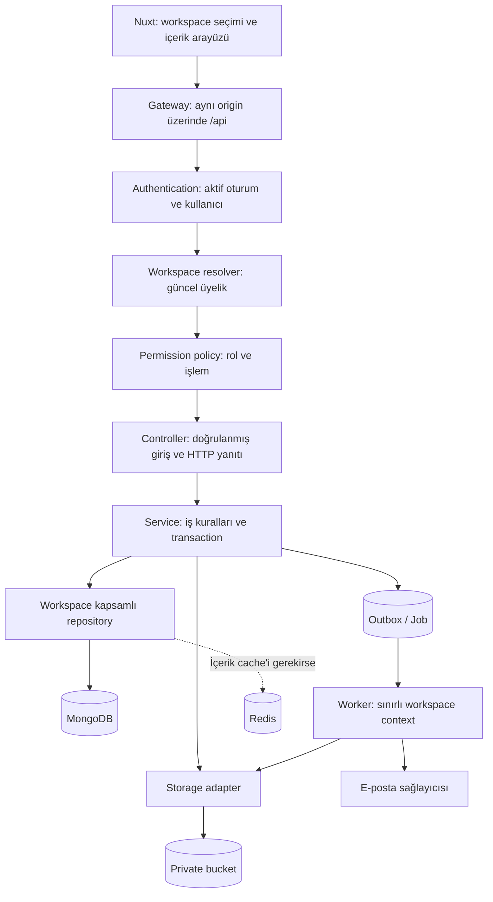
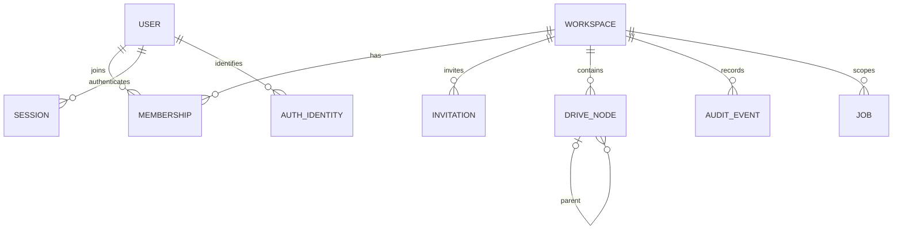
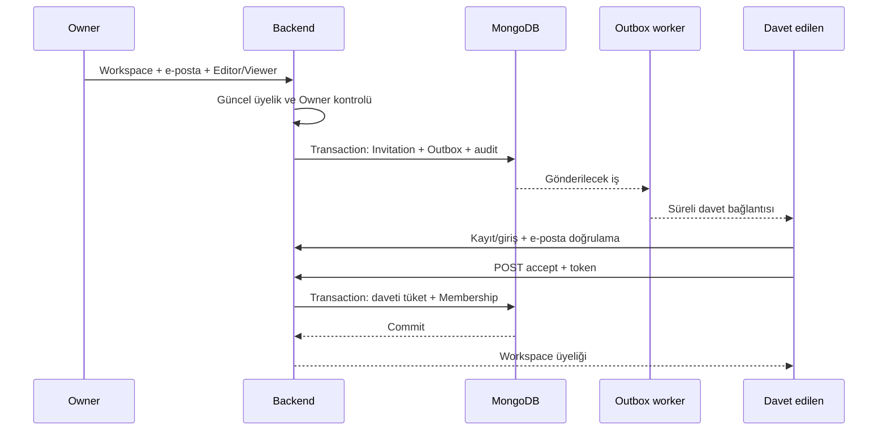

# Google Drive Clone: Multi-tenant Mimari Tasarımı

**Tarih:** 12 Ekim 2026  
**Aşama:** Mimari tasarım referansı; uygulama21 Ekim2026 itibarıyla kuruldu. Güncel uçlar için frontend API sözleşmesi, doğrulanmış kapsam ve kalan canlı kurulum/kabul işleri için kalite raporu esas alınmalı. Owner işlem geçmişi okuma API/ekranı ve açık indirmelerde erişim kaybını izleme de uygulandı.  
**Temel teknoloji:** Ayrı Nuxt frontend; Node.js/Express backend; MongoDB/Mongoose; özel erişimli dosya bucket'ı.

## 1. Temel karar: tenant bir workspace'tir

Bir kullanıcının tek hesabı bulunur; bu hesap birden fazla workspace'e üye olabilir. **Rol, User üzerinde global bir alan olarak tutulmaz. Her workspace üyeliğinin ayrı rolü vardır.**

```text
Ahmet
  ├ Workspace A → Owner
  ├ Workspace B → Editor
  └ Workspace C → Viewer
```

Workspace A'daki Owner yetkisi, Workspace B veya C'ye taşınmaz. Kullanıcının henüz workspace'i olmayabilir; oluşturduğunda yeni workspace'in Owner üyeliği otomatik oluşur.

Başlangıç için tek MongoDB veritabanında ortak collection'lar seçildi. Workspace'e ait her belgede zorunlu `workspaceId` bulunacak. İzolasyon, uygulamanın tüm veri erişiminde uygulanacak; MongoDB'nin otomatik satır bazlı kullanıcı yetkilendirmesi olduğu varsayılmayacak. Bu yaklaşımın operasyonel kolaylığı var; tenant filtresinin atlanmasını engellemek kritik sorumluluk. Daha güçlü fiziksel ayrım gerekiyorsa tenant başına veritabanı/ayrı altyapı ayrıca değerlendirilebilir. [MongoDB multi-tenant rehberi](https://www.mongodb.com/docs/atlas/build-multi-tenant-arch/).

**Kural:** Workspace context'i bulunmayan bir çağrı, tenant verisine erişemez. Bir ID'yi bilmek, o kaynağa erişme hakkı vermez.

## 2. Bileşenler ve güven sınırları



Frontend ve backend ayrı repository ve deployment olarak kalır. Önerilen gateway, tarayıcıya tek origin altında `/api` sunup istekleri ayrı backend'e iletir. Böylece cookie/CSRF yönetimi sadeleşir. Backend'e doğrudan gelen istekler de aynı authentication ve policy kontrollerinden geçmek zorundadır.

| Bileşen | Sorumluluk |
| --- | --- |
| Identity/Auth | Kullanıcı hesabı, e-posta doğrulama, Google girişi ve oturum |
| Workspace | Workspace oluşturma, ayarlar ve yaşam döngüsü |
| Membership | Workspace üyeliği, rol değişimi ve üye çıkarma |
| Invitation | E-posta bazlı davet, süre ve tek kullanım |
| Drive | Dosya/klasör metadata'sı, ağaç ve içerik işlemleri |
| Storage | Private bucket işlemleri; kullanıcı yetkisi kararı vermez |
| Policy | Açık permission tablosu; bilinmeyen işlem/rol için ret |
| Repository | Tenant filtresini her veri işlemine ekleyen tek erişim kapısı |
| Outbox/Worker | Transaction sonrası e-posta ve uzun süren işlerin güvenilir yürütülmesi |
| Audit | Workspace yönetiminde kim, hangi işlem, hangi kaynak bilgisi |

Microservice'e bölmek yerine başlangıçta bu modülleri tek backend içinde tutmak tasarım kararıdır. E-posta ve ağır dosya işleri ayrı worker sürecinde çalışabilir.

## 3. Veri modeli



### Global kimlik belgeleri

| Model | Temel alanlar | Kural |
| --- | --- | --- |
| User | `_id`, `name`, `emailNormalized`, `emailVerifiedAt`, `passwordHash?`, `status` | Workspace rolü içermez; Google hesabında parola bulunmayabilir |
| AuthIdentity | `userId`, `provider`, `subject` | Google kullanıcı kimliği `sub`; `(provider, subject)` unique |
| Session | `userId`, `tokenHash`, `expiresAt`, `revokedAt` | Her istekte geçerlilik kontrolü; rol saklanmaz |
| EmailVerification | `userId`, `tokenHash`, `expiresAt`, `consumedAt` | E-posta sahipliği doğrulaması; tenant erişimi vermez |

Global modeller için tenant repository kullanılmaz; ayrı identity repository'leri yalnız kendi sorumluluklarına erişir. Workspace verisini global kullanıcı sorgusuna kontrolsüz join etmek yasaktır.

### Workspace kapsamındaki belgeler

| Model | Temel alanlar | Kural |
| --- | --- | --- |
| Workspace | `_id`, `name`, `createdBy`, `status`, `ownerCount`, `authorizationVersion`, `mutationSequence` | `createdBy` audit bilgisidir; kalıcı yetki kaynağı Membership'tir |
| Membership | `_id`, `workspaceId`, `userId`, `role`, `status`, `version` | Rol yalnız `owner/editor/viewer`; durum `active/removed` |
| Invitation | `_id`, `workspaceId`, `emailNormalized`, `role`, `tokenHash`, `expiresAt`, `status`, `invitedBy`, `acceptedBy?`, `version` | Davet rolü yalnız `editor/viewer`; durum `pending/accepted/revoked` |
| DriveNode | `_id`, `workspaceId`, `kind`, `parentId`, `name`, `createdBy`, `status`, `version`, timestamps | `kind: file/folder`; bir belge her zaman tek workspace'e ait |
| AuditEvent | `workspaceId`, `actorUserId`, `action`, `targetId`, `requestId`, `createdAt` | Token, parola/hash ve dosya içeriği loglanmaz |
| Job | `workspaceId`, `type`, `targetId`, `requestedBy`, `status`, `attempts`, `leaseUntil` | Background işinin tenant ve hedef kapsamı zorunlu |

Dosya ve klasörler aynı `drive_nodes` collection'ında `kind` alanıyla ayrılır. Bu, aynı klasörde dosya ve alt klasörleri tek sorgu/sayfalama ile listelemeyi kolaylaştırır. Mongoose discriminator veya aynı schema'da tür kuralları kullanılabilir. File/Folder API'leri bu ortak repository'nin türü kısıtlayan metotlarını çağırır.

File türüne ek alanlar: `objectKey`, `mimeType`, `size`, `checksum?`, `storageState`. Folder türünde bucket object key bulunmaz. `parentId: null` workspace kökünü temsil eder. Parent varsa aynı workspace'in aktif bir Folder kaydı olmalı. Döngü oluşturacak taşıma reddedilir.

DriveNode durumları `pending-upload/active/deleting/deleted` olarak tanımlanır. Folder doğrudan active oluşturulur; File ancak finalize doğrulaması sonrası active ve `storageState:ready` olur. Upload durumları `initiated/completed/cancelled/expired`; üyeliğin kaldırılması veya süre aşımı yeni finalize işlemini engeller. Pending upload içerik listesine ve download'a dahil edilmez.

Outbox belgelerinde kapsam açıkça `identity` veya `workspace` olur. Workspace davet ve dosya işleri için `workspaceId` zorunludur; global e-posta doğrulama işi workspace context'i taklit etmez.

### İndeksler ve bütünlük

- User: `emailNormalized` unique. Normalizasyon kayıt, giriş ve davette aynı uygulanır; sağlayıcıya özel nokta/`+` silme yapılmaz.
- Membership: `(workspaceId, userId)` unique; ayrıca `(userId, status, workspaceId)` workspace listesi için.
- Invitation: `(workspaceId, emailNormalized)` unique; bir alıcı için son davet kaydı tutulur, yeniden davette token/version yenilenir. Geçmiş AuditEvent'te kalır. `tokenHash` unique.
- DriveNode: `(workspaceId, parentId, status, kind, name, _id)` başlangıç indeks adayı; gerçek listeleme sıralamasıyla uygulama sırasında doğrulanır.
- Session/verification: token hash unique; `expiresAt` üzerinde temizleme TTL'i.
- Job/Outbox: durum ve sonraki deneme zamanı üzerinden worker taraması; lease ile iş sahiplenme.

Unique indeksler migration/bootstrap sırasında gerçekten oluşturulup doğrulanır. Yalnız Mongoose schema'sında `unique` yazılması yeterli kabul edilmez; duplicate key hataları kontrollü conflict yanıtına çevrilir.

Dosya/klasör adları için başlangıçta benzersizlik kısıtı koymuyoruz; aynı isimli kayıtlar ID ile ayrılır. Bu bir ürün tasarım kararıdır.

TTL temizliğe yardımcı olur; davet veya oturumun geçerli sayılması her zaman backend'in `expiresAt > now` kontrolüne bağlıdır. TTL silmesi anlık değildir. [MongoDB TTL](https://www.mongodb.com/docs/manual/core/index-ttl/).

## 4. Yetki matrisi ve politika

Makineyle okunabilir tasarım tanımı: `docs/multi-tenant-permissions.json`. Bu dosya henüz runtime'a bağlı değildir.

| İşlem | Owner | Editor | Viewer |
| --- | --- | --- | --- |
| Workspace adını ve kendi yetkilerini görme | Evet | Evet | Evet |
| İçerik listeleme, metadata, önizleme, indirme | Evet | Evet | Evet |
| Dosya yükleme / klasör oluşturma | Evet | Evet | Hayır |
| Kapsamdaki içerik metadata'sını güncelleme / taşıma | Evet | Evet | Hayır |
| İçerik silme | Evet | Evet | Hayır |
| Üyeleri ve davetleri yönetim ekranında listeleme | Evet | Hayır | Hayır |
| Editor/Viewer daveti gönderme / iptal | Evet | Hayır | Hayır |
| Üye çıkarma / rol değiştirme | Evet | Hayır | Hayır |
| Workspace ayarlarını değiştirme / workspace silme | Evet | Hayır | Hayır |
| Workspace yönetim audit kayıtlarını görme | Evet | Hayır | Hayır |

Üye listesi ve audit erişimini Owner ile sınırlamak tasarım kararıdır; içerik görüntülemek için bütün üyelerin e-postalarına erişmek gerekmez. Düzenleme burada metadata ve içerik yönetimidir; dosya içeriği düzenleyen bir editör PDF kapsamına eklenmez.

Permission kararı dört koşulun birlikte sağlanmasına bağlıdır:

```text
Aktif kullanıcı/oturum
AND aktif workspace üyeliği
AND rolün istenen permission'a sahip olması
AND hedefin/ilişkili kaynakların aynı workspace'e ait olması
```

Owner dahil bütün roller tenant filtresine tabidir. Bilinmeyen rol, permission veya eksik context varsayılan olarak reddedilir. UI'ın gönderdiği `role`, `permissions`, `isOwner`, `userId` alanları yetki kaynağı olamaz. Her request'te izin denetimi yapılması ve varsayılan ret yaklaşımı [OWASP Authorization](https://cheatsheetseries.owasp.org/cheatsheets/Authorization_Cheat_Sheet.html) ile uyumludur.

### Owner yaşam döngüsü

Başlangıçta oluşturan kişi tek Owner'dır. Tasarım, daha sonra mevcut üyelerin Owner'a yükseltilmesine izin verir; e-posta davetiyle doğrudan Owner atanamaz. Birden fazla Owner'a izin vermek, gereksinimde belirtilmeyen bu durum için seçilen ürün politikasıdır.

**Aktif workspace'te en az bir aktif Owner kalır.** Son Owner çıkarılamaz veya Editor/Viewer'a düşürülemez. Sahiplik devri endpoint'i yeni Owner'ı yükseltip eski Owner'ın yeni rolünü aynı transaction içinde uygular. `ownerCount` ve üyelikler sadece bu kontrollü transaction'larda değiştirilir; istemci owner sayısı gönderemez.

## 5. Authentication ve oturum

Web uygulaması için server-side oturum seçildi: tahmin edilemeyen rastgele session token'ı cookie'de, hash'i Session kaydında tutulur. Cookie `HttpOnly`, `Secure`, uygun `SameSite`, `Path=/` ile verilir; aynı-origin gateway düzeninde `__Host-` öneki ve Domain verilmemesi tercih edilir. Backend session süresini, iptal durumunu ve kullanıcı durumunu kontrol eder. Login sırasında oturum kimliği yenilenir; logout kaydı iptal eder. Rol bilgisi cookie/JWT içinde kalıcı karar olarak saklanmaz. [OWASP Session Management](https://cheatsheetseries.owasp.org/cheatsheets/Session_Management_Cheat_Sheet.html).

Durum değiştiren cookie tabanlı isteklerde oturuma bağlı CSRF token'ı ve Origin kontrolü uygulanır. CORS veya SameSite tek başına yetkilendirme kontrolü sayılmaz. [OWASP CSRF](https://cheatsheetseries.owasp.org/cheatsheets/Cross-Site_Request_Forgery_Prevention_Cheat_Sheet.html).

- E-posta/şifre: parola hash'i parola saklamaya uygun bir algoritmayla tutulur; mevcut starter HMAC zinciri taşınmaz.
- Workspace işlemleri ve davet kabulü için doğrulanmış e-posta gerekir. Bu, e-posta adresi yazılarak başka kişinin davetinin alınmasını önleyen tasarım kuralıdır.
- Google: Authorization Code akışı, `state`, `nonce` ve sağlayıcı/library desteğiyle PKCE; ID token imzası, issuer, audience ve expiry backend'de doğrulanır.
- Google hesabının sabit bağlantısı `provider + sub` ile kurulur. E-posta eşleşmesiyle mevcut hesaba sessiz otomatik bağlama yapılmaz; mevcut hesaba giriş/yeniden doğrulama ile açık hesap bağlama akışı gerekir.
- Davet adresinin sahipliği uygulamanın e-posta doğrulama politikasıyla teyit edilir; yalnız istemcinin veya profil formunun beyanı kullanılmaz.

Google'ın kullanıcıyı sabit `sub` alanıyla tanımlama kuralı [OpenID Connect dokümantasyonunda](https://developers.google.com/identity/openid-connect/openid-connect) açıklanır.

## 6. Request context ve veri erişimi

Workspace route'ları `/api/v1/workspaces/:workspaceId/...` altında bulunur. Workspace seçimi route üzerinden yapılır; body/header'dan gelen başka bir tenant değeri kullanılmaz. Ayrı/global endpoint istisnaları aşağıda açıkça belirtilmiştir.

```text
validateRequest
→ authenticateSession
→ requireVerifiedEmail
→ resolveWorkspaceContext
→ requirePermission(action)
→ controller
→ service
→ workspaceRepository
```

`resolveWorkspaceContext`, Workspace'i aktif durumda ve Membership'i `{workspaceId, userId, status:'active'}` ile bulur. Context server'da üretilir:

```text
WorkspaceContext = {
  workspaceId, actorUserId, sessionId,
  membershipId, role, authorizationVersion, requestId
}
```

Context body'den deserialize edilmez. Factory ve repository sınırı uygulamada kontrol edilir; yalnız TypeScript tipine veya objede `workspaceId` bulunmasına güvenilmez. Background işlere ayrı, sınırlı SystemWorkspaceContext üretilir.

Repository'nin API'si dar tutulur: `getFileById`, `listChildren`, `updateNodeMetadata`, `removeMember` gibi açık metotlar. Controller/service ham Mongoose modelini import edip kapsam dışı `findById` çalıştıramaz. Global identity sorguları ayrı modüllerdedir.

Örnek repository sözleşmesi:

```js
// Kavramsal örnek: context backend'de doğrulanmış olmalı.
return DriveNode.findOne({
  _id: nodeId,
  workspaceId: context.workspaceId,
  kind: 'file',
  status: 'active',
})
```

Bu sorgu tek başına tüm policy değildir; oturum/üyelik/permission ve aktif parent zinciri de kontrol edilmelidir. Kaynak ID başka workspace'ten gelirse sonuç bulunmaz.

İzolasyon kuralları:

1. Her tenant okuma, yazma, count, bulk ve aggregate işlemi workspace filtresi içerir.
2. `$lookup` gibi ilişkili collection okumaları da kendi workspace filtresine sahiptir.
3. `parentId`, `nodeId`, `membershipId`, `invitationId` ilgili workspace içinde doğrulanır; aynı workspace parent'ı ayrıca aktif Folder olmalıdır.
4. Create işleminde `workspaceId`, `createdBy`, rol ve storage key server tarafından atanır. Update alanları allowlist ile seçilir; kind/workspace/sahiplik keyfi değiştirilemez.
5. `req.body` doğrudan Mongo filtresine veya update objesine geçirilmez. Query parametreleri doğrulanır; sayfalama boyutu sınırlandırılır.
6. İlişki/kapsam hataları bilgi sızdırmadan sonuçlandırılır; response DTO'su hash, token ve iç depolama bilgilerini dışarı vermez.

## 7. Transaction ve eşzamanlı yetki değişimleri

Transaction gereken temel işlemler:

- Workspace oluşturma + ilk Owner üyeliği + audit.
- Davet kaydı + e-posta Outbox kaydı + audit.
- Davet kabulü + üyelik oluşturma/yeniden aktifleştirme + davetin tüketilmesi.
- Rol değiştirme/üye çıkarma + ownerCount/authorizationVersion güncelleme + audit.
- Sahiplik devri ve içerik ilişkisini değiştiren kısa yazma işlemleri.

MongoDB multi-document transaction kullanımı için replica set veya uygun sharded deployment gerekir; yerel geliştirme de replica set olarak kurulmalıdır. Starter Compose'daki standalone Mongo yapılandırması bu tasarım için yeterli kabul edilmez. [MongoDB Transactions](https://www.mongodb.com/docs/manual/core/transactions/).

Bu işlemlerde `readConcern: snapshot`, `writeConcern: majority` ve primary okuma kullanımı planlanır. Repository'nin transaction session'ı bütün ilgili sorgu/yazmalara aktarılır; transaction dışında yanlışlıkla çalışan bir model çağrısı aynı bütünlük garantisine dahil sayılmaz.

**Sadece transaction kullanmak, birbirinden farklı üyelikleri değiştiren iki Owner'ın son Owner kuralını bozmasını tek başına önlemez.** Ortak Workspace belgesi üzerinde kontrollü bir yazma noktası bulunur:

1. Transaction callback'inde güncel oturum/kullanıcı, Workspace ve actor Membership tekrar okunur; permission yeniden değerlendirilir.
2. Workspace'in aktif olması ve beklenen `authorizationVersion` ile eşleşmesi koşuluyla `mutationSequence` artırılır. Bu, aynı workspace'teki kısa değişiklikleri ortak belgede çakıştırır.
3. İşlem ve bütün ilgili kontroller transaction içinde uygulanır. Üyelik/rol değişiminde `authorizationVersion` artırılır; Owner değişiminde `ownerCount` aynı transaction'da güncellenir.
4. Çakışmada bütün callback yeni context ile tekrar değerlendirilir. Eski rol/context yeniden kullanılmaz; audit/outbox kaydı rollback ile geri alınır. Dış e-posta/bucket işlemi callback içinde yapılmaz.

Bu tasarım role downgrade ile içerik yazmasının hangi sırada commit ettiğini belirler: rol değişimi önce commit olduysa tekrar denenen yazma yeni role göre değerlendirilir; gerekli permission kaybedilmişse reddedilir. Owner'dan Editor'a geçen kişinin içerik yazma yetkisi devam eder. Son Owner için koşullu sayaç güncellemesi ve üyelik yazması birlikte commit olmalıdır. Transaction'lardaki yazma çakışması ve eski snapshot okumaları [MongoDB üretim değerlendirmelerinde](https://www.mongodb.com/docs/manual/core/transactions-production-consideration/) ele alınır.

Bu ortak yazma noktası MVP için anlaşılır bir güvenlik/tutarlılık tercihi; yoğun bir workspace'te darboğaz olabilir. Ağır dosya aktarımı ve büyük ağaç temizliği transaction dışında yürütülür; işlemin başlatılması/finalize edilmesi kısa transaction'lardır. Daha ince kilitleme ancak aynı güvenlik kabul senaryolarını koruyarak değerlendirilir.

Yeni API istekleri güncel yetkiyi kullanır. Daha önce yetkiliyken tamamlanmış bir işlem veya istemciye indirilmiş veri geriye alınamaz; rol değişiminin eski veriyi silme garantisi olduğu söylenmez.

## 8. Workspace oluşturma ve davet akışı

### Workspace oluşturma

Doğrulanmış kullanıcı `POST /workspaces` çağırır. Backend workspace ID üretir; `createdBy` current user, `ownerCount:1`, aktif durum ve ilk `owner` Membership aynı transaction'da oluşturulur. İstemci rol seçmez. Aynı istek tekrar gönderildiğinde ikinci workspace oluşmaması için kullanıcıya bağlı idempotency key desteği planlanır.

### Davet oluşturma

1. Owner, workspace route'unda `{email, role}` gönderir; rol sadece Editor veya Viewer.
2. Backend email'i ortak kuralla normalize eder, mevcut aktif üyeliği ve ilgili daveti kontrol eder. Zaten üye olan kişiye davet rol değiştirmenin kısayolu olamaz.
3. Kriptografik rastgele token üretilir. Invitation'da hash saklanır. Tasarım başlangıç süresi **72 saat**; configurable ürün politikasıdır.
4. Yeniden davette eski token geçersiz kılınır; son kayıt yeni token/version ile güncellenir.
5. Invitation ve Outbox transaction ile kaydedilir. Outbox'ın davet linki taşıyan payload'ı şifreli tutulur; token/log/query string sızıntısı önlenir.
6. Worker davetin aktifliğini, süresini ve Outbox kaydındaki invitation version'ın güncelliğini kontrol ederek e-postayı gönderir; sağlayıcı hatalarında sınırlı retry uygulanır. Yenilenen davetin eski Outbox işi gönderilmez. Kullanıcı hesabı önceden oluşturulmaz.

Link önerisi: `https://app.example.com/invitations/accept#token=...`. Fragment HTTP request/referrer'a taşınmaz; frontend token'ı POST body'sine koyar. Sayfa üçüncü taraf analiz script'i kullanmaz, token kalıcı browser storage'a kaydedilmez. Linkin GET ile açılması daveti tüketmez.



### Davet kabulü

Kabul, mevcut üyelik gerektiren workspace middleware'inden geçmez; henüz üye olmayan kişiye üyelik sağlayan kontrollü bir identity akışıdır.

- Aktif session/user ve doğrulanmış e-posta şarttır.
- Workspace ID client'tan alınmaz; token hash ile bulunan Invitation'dan çıkarılır.
- Davet pending, süresi geçmemiş, workspace aktif ve kullanıcının doğrulanmış email'i davetle eşleşmiş olmalıdır.
- Transaction'da Workspace yazma noktası kullanılır. Davet pending/expiry/version koşuluyla tüketilir; `(workspaceId,userId)` unique üyelik eklenir veya removed üyelik verilen Editor/Viewer rolüyle aktifleştirilir.
- Aktif üyeliğin rolü davet kabulüyle değiştirilmez. İki eşzamanlı kabul ikinci üyelik oluşturamaz.
- Başarıyla kabul eden aynı kullanıcı için aynı kabulün tekrarı mevcut üyelikle idempotent sonuç verebilir; başka kullanıcıya hak vermez. Üyelik sonradan çıkarılmışsa eski kabul token'ı yeniden aktifleştiremez.
- İptal, süre aşımı ve yanlış kullanıcı bütünlük koşullarını geçemez. Yeni davet gerekir.

## 9. API sözleşmesinin iskeleti

Temel prefix `/api/v1`. `:wid` istenen workspace'i, `:mid/:iid/:nid/:fid` o workspace içindeki kaynak ID'lerini temsil eder. Bütün ID'ler format ve kapsam bakımından doğrulanır.

### Identity ve üyelik edinme istisnaları

| Endpoint | Gerekli kontrol |
| --- | --- |
| `POST /auth/register`, `/auth/login` | Doğrulama, hız sınırlama; kullanıcı/workspace verisi sızdırmayan yanıt |
| `GET /auth/google/start`, `/auth/google/callback` | state/nonce/code/ID token doğrulaması |
| `POST /auth/email-verification/confirm` | Süreli, tek kullanımlı doğrulama token'ı |
| `POST /auth/logout` | Session + CSRF; oturum iptali |
| `GET /auth/me` | Session; güvenli kullanıcı DTO'su |
| `GET /workspaces` | Session + doğrulanmış email; yalnız aktif üyeliklerden türetilen workspace listesi |
| `POST /workspaces` | Session + doğrulanmış email; otomatik Owner |
| `POST /invitations/inspect` | Session + doğrulanmış eşleşen email + token; yalnız davet özeti |
| `POST /invitations/accept` | Session + doğrulanmış eşleşen email + token; özel transaction akışı |

Bu istisnalar tenant middleware'ini keyfi atlayan genel CRUD kapıları değildir; her birinin özel veri erişim sözleşmesi vardır. Cookie ile durum değiştiren isteklerde CSRF kontrolü uygulanır.

### Workspace kaynakları

| Endpoint | Permission | Alan sınırı |
| --- | --- | --- |
| `GET /workspaces/:wid` | `workspace:read` | Ad + kullanıcının rol/capabilities bilgisi |
| `PATCH /workspaces/:wid` | `workspace:update` | Allowlist ayarlar; ownerCount/createdBy client'tan değişmez |
| `DELETE /workspaces/:wid` | `workspace:delete` | Silme durumu + temizleme işi |
| `GET /workspaces/:wid/members` | `members:read` | Aynı workspace üyeleri |
| `POST /workspaces/:wid/invitations` | `members:invite` | Editor/Viewer email daveti |
| `GET /workspaces/:wid/invitations` | `invitations:read` | Aynı workspace, token hariç |
| `DELETE /workspaces/:wid/invitations/:iid` | `invitations:revoke` | Pending daveti iptal |
| `PATCH /workspaces/:wid/members/:mid/role` | `members:update-role` | owner/editor/viewer; son Owner korunur |
| `DELETE /workspaces/:wid/members/:mid` | `members:remove` | Son Owner korunur |
| `POST /workspaces/:wid/ownership-transfer` | `members:update-role` | Hedef aktif üye; iki rol birlikte güncellenir |
| `GET /workspaces/:wid/nodes` | `content:read` | Workspace + parent + aktif ağaç; sınırlı sayfalama |
| `GET /workspaces/:wid/nodes/:nid` | `content:read` | Aynı workspace ve aktif parent zinciri |
| `POST /workspaces/:wid/folders` | `content:create` | Parent aynı workspace ve Folder |
| `POST /workspaces/:wid/files/uploads` | `content:create` | Server'ın seçtiği object key ve parent |
| `POST /workspaces/:wid/files/uploads/:uploadId/complete` | `content:create` | Güncel üyelik/rol + server upload kaydı + bucket doğrulaması |
| `PATCH /workspaces/:wid/nodes/:nid` | `content:update` | İzinli metadata; parent taşıması kapsam/döngü kontrolüyle |
| `DELETE /workspaces/:wid/nodes/:nid` | `content:delete` | Mantıksal erişim kapatma + temizleme işi |
| `GET /workspaces/:wid/files/:fid/content` | `content:read` | Private bucket'tan kontrollü indirme/önizleme |
| `GET /workspaces/:wid/folders/:nid/archive` | `content:read` | Aynı workspace'in aktif alt ağacı |
| `GET /workspaces/:wid/archives/:id` | `content:read` | Uygulanan arşiv durum sorgusu; tenant ve talep eden kullanıcı kontrolü |
| `GET /workspaces/:wid/audit-events` | `audit:read` | Uygulanan Owner işlem geçmişi; imzalı cursor ile sayfalama, sınırlı actor DTO'su |

`content:read` bulunan herkes her tür job'a erişemez; örneğin davet gönderim işinin detayları Owner'a özgü policy'de kalır. Kaynak güncellemelerinde `version`/`If-Match` ile kayıp güncelleme kontrolü uygulanır.

### Hata davranışı

- `400`: Geçersiz ID/body/query.
- `401`: Oturum yok, süresi geçmiş veya iptal edilmiş.
- `403`: Doğrulanmış email gerekli ya da üye olunan workspace'te işlem yetkisi yok.
- `404`: Workspace üyeliği yok; kaynak başka workspace'te/yok/erişime kapalı; davet kullanılamıyor. Yetkisiz kullanıcıya varlık bilgisi açıklanmaz.
- `409`: Son Owner kuralı, aktif üyeye davet, version çakışması veya ilişki/döngü çakışması.
- `429`: Hız sınırı.
- `500/503`: Kontrollü sunucu/bağımlılık hatası; stack ve sırlar dışarı verilmez.

Yanıt biçimi: `{error:{code,message,requestId}}`. Kaynak bulunamadı diye filtresiz ikinci sorgu yapıp başka tenant verisi açıklanmaz.

## 10. Dosya, ağaç, cache ve worker sınırları

### Bucket ve upload

Bucket private olur. Örnek internal object key: `workspaces/<wid>/objects/<nodeId>/<uploadId>`. Prefix düzen sağlar; tek başına erişim kontrolü değildir. Kullanıcı object key/bucket adresi seçmez. Storage adapter sadece doğrulanmış workspace kaydıyla çalışır.

Upload kaydı ayrı `Upload` modeli olarak `workspaceId`, `nodeId`, `initiatedBy`, `objectKey`, `expiresAt`, `state` taşır. Başlatma/finalize API'leri güncel create permission'ını kontrol eder. Doğrudan bucket upload için kısa süreli, belirli key/işleme bağlı bir URL kullanılabilir; finalize öncesi key, gerçek boyut/tür ve upload sahibi doğrulanır. Create yetkisini kaybeden kullanıcı dosyayı finalize edemez; kabul edilmemiş/yarım objeler cleanup ile silinir. Upload mümkün olduğunda storage sağlayıcısının boyut/tür kısıtlarıyla sınırlandırılır; backend ayrıca doğrular.

Upload başlatmada pending File, Upload ve audit aynı kısa transaction'da oluşturulur; finalize, upload state/version ve dosya kaydını birlikte günceller. Retry aynı node/object kaydını kullanır. Finalize hem `kind:file` hem doğru parent/workspace hem de aktif parent zinciri kontrolü yapar.

### İndirme ve önizleme

Download/preview, backend veya onun policy uygulayan gateway'i üzerinden akışla sunulur; frontend'e kalıcı/public bucket URL verilmez. Böylece yeni istekte üyelik/rol tekrar kontrol edilir. Önceden verilmiş download signed URL'lerinin anlık iptali varsayılmadığı için bu tasarımda genel dosya indirme yetkisi olarak kullanılmazlar.

Range istekleri aynı kontrollerden geçer. Zararlı aktif içerik aynı-origin uygulama olarak render edilmez; uygun preview türü allowlist'i, güvenli content headers ve gerekirse cookie taşımayan sandbox origin kullanılır. Download varsayılanı attachment'tır. Açık dosya/ZIP stream'lerinde oturum, hesap, üyelik ve aktif kaynak zinciri250 ms beklemeli kontrollerle tekrar okunur; her kontrol1 saniyede tamamlanmazsa veya erişim kaybı görülürse bağlantı sonlandırılır. Bu gerçek zamanlı garanti değildir; ağ/event-loop gecikmesi ve önceden gönderilmiş baytlar geri alınamaz. Aynı süreçte32, kullanıcı başına4 izlenen akış sınırı vardır.

### Ağaç ve silme

Folder taşımasında yeni parent aynı workspace'te aktif Folder olmalı; parent zinciri yürünerek döngü engellenir. İlgili metadata yazması kısa workspace transaction'ında yapılır.

Silmede kök node önce erişime kapatılır (`deleting`), temizlik işi oluşturulur. Alt düğümün aktif olması tek başına yeterli değildir: **parent zincirindeki tüm klasörler aktif olmalıdır**. Bu kontrol doğrudan dosya erişiminde, listede, aramada, archive'ta ve yeni child oluştururken geçerlidir. Worker alt ağacı aynı workspace içinde temizler; eksik parent da erişimi kapatır. Büyük ağaç silmesi tek transaction'a sığdırılmaz. Ürün bu aşamada çöp kutusu/restore özelliği eklemez; silme işinin dahili durumları kullanılır.

Workspace silmede durum önce `deleting` yapılır; normal tenant resolver erişimi kapatır. Cleanup worker, bu durum için açıkça izinli sistem bağlamıyla çalışır. İşlerin hedefi tenant filtresiyle tekrar doğrulanır; tekrar çalışmaları tutarlı olmalıdır.

### Cache

Başlangıçta üyelik ve rol doğrulaması DB'den yapılır; permission cache'i eklenmez. İçerik cache'i gerekirse anahtar workspace + kaynak/parent + filtre/sıralama/sayfa + veri sürümünü içerir. Backend cache'e bakmadan önce yetki kontrolünü yapar. Cache arızasında veri erişimi policy atlanarak açılmaz. Genel liste sonucu bütün tenant'lar için tek model adıyla cache'lenmez.

### Worker

Job'un tenant ve hedefi transaction sırasında server'da yazılır; istemcinin serbest `workspaceId`/object key bilgisi worker komutu olmaz. Dispatcher, yalnız kayıtlı iş türüne ve hedefe erişebilen SystemWorkspaceContext üretir; genel `isAdmin/isSystem` bypass'ı yoktur. Kullanıcıya veri çıkaran export gibi işler teslimden önce güncel üyeliği/permission'ı tekrar kontrol eder. Daha önce yetkili başlatılmış cleanup işleri ise sadece kaydedilmiş kapsamı tamamlayabilir.

Bu katmanlardaki tenant context, cache ve depolama ayrımını birlikte koruma yaklaşımı [OWASP Multi Tenant Security](https://cheatsheetseries.owasp.org/cheatsheets/Multi_Tenant_Security_Cheat_Sheet.html) ile karşılaştırılmıştır.

## 11. Backend ve frontend klasör yapısı

Bu ağaçlar yeni repository'ler için planlanan yapıdır; bu görevde klasörler/kod oluşturulmadı.

```text
google-drive-clone-backend/
  src/
    app/                 # createApp, bootstrap, route registration
    config/              # env validation, database, storage, mail
    shared/              # error, request context, logging, transactions
    modules/
      auth/              # identity, email verification, session, Google
      workspaces/        # workspace lifecycle
      memberships/       # role and owner rules
      invitations/       # invite lifecycle
      drive/             # nodes, uploads, folder tree
      audit/             # workspace management events
    policy/              # permission registry, requirePermission
    tenancy/             # context factories and transaction boundary
    infrastructure/      # storage/mail adapters, scoped persistence
    workers/             # outbox, cleanup, exports
  tests/                 # policy + API isolation + integration

google-drive-clone-frontend/
  pages/                 # auth, workspace selection, drive, management
  components/            # file browser, folder tree, member/invite forms
  composables/           # API calls and workspace context
  middleware/            # navigation/login guidance
  stores/                # identity, active workspace, UI capabilities
```

Frontend aktif workspace değiştiğinde önceki request'leri iptal eder, query cache'ini workspace ID ile ayırır ve eski içerik görünümünü temizler. Workspace detayından backend'in hesapladığı capabilities alınır; UI bunlara göre butonları gösterir. `403/404` sonrasında rol/üyelik görünümü güncellenir. Nuxt route middleware'i kullanıcı deneyimini düzenler; gerçek yetki backend'dedir.

## 12. Starter repodan uyarlanacak ve değiştirilecek noktalar

| Mevcut fikir | Yeni tasarımdaki karşılığı |
| --- | --- |
| Route/controller/service ayrımı | Korunacak; context ve permission sözleşmesi eklenecek |
| Generic BaseService `findById`, filtresiz `load` | Tenant-aware, dar repository metotlarıyla değiştirilecek |
| JWT içindeki `_doc` ile kullanıcı/rol | Minimal identity + canlı server session/Membership kontrolü |
| Model adıyla cache | Workspace ve sorgu kapsamlı cache |
| User belgesinin tamamını response/log'a verme | Açık DTO ve hassas alan filtreleme |
| Startup'ta beklenmeyen bağlantılar/demo queue | Bağlantıların doğrulandığı bootstrap; kontrollü worker |
| Eksik Profile modülü/hata helper akışı | Yeni auth alanında açık modeller ve merkezi error handling |
| Standalone Mongo Compose | Transaction destekleyen yerel replica set |

Eski Todo endpoint'leri yeni Drive API'nin yanına filtresiz erişim yolu olarak taşınmaz. Yeni backend ayrı repository olarak kurulacağı için starter öğrenme referansı olarak kalır.

## 13. Uygulama sırasında geçmesi gereken kabul senaryoları

Bu liste test planıdır; testlerin geçtiğine ilişkin bir sonuç değildir.

1. Workspace oluşturan doğrulanmış kullanıcı aynı transaction'da tek aktif Owner üyeliğini alır.
2. Bir kullanıcı A'da Owner, B'de Viewer iken B'de içerik yazamaz; A rolü B'ye taşınmaz.
3. Üye olmadığı workspace'i ve onun dosya/klasör/member/invitation ID'lerini doğrudan API'de kullanamaz.
4. Viewer bütün okuma/indirme/önizleme akışlarını yapar; oluşturma/update/delete `403` olur ve DB/bucket değişmez.
5. Editor içerik yönetebilir; üyelik, rol, davet ve workspace yönetimi `403` olur.
6. Owner bütün kendi-workspace işlemlerini yapar; başka workspace'e yine erişemez.
7. Davet rolüne `owner` veya bilinmeyen değer gönderilirse reddedilir; aktif üyenin rolü yeniden davetle değişmez.
8. Kayıtsız e-posta davet alır; kayıt/giriş ve doğrulama sonrası Editor/Viewer üyeliği kazanır.
9. Başkasının doğrulanmış e-postası, süresi geçen/revoked token ve tüketilmiş eski davet üyelik oluşturamaz.
10. Eşzamanlı iki kabul tek Membership oluşturur; tekrar gönderim yetkiyi yükseltmez.
11. Eşzamanlı Owner çıkarma/düşürme sonunda aktif workspace Owner'sız kalmaz; `ownerCount` üyeliklerle tutarlıdır.
12. Üyelik/rol değişimi önce commit olduysa eski permission ile yazma transaction'ı commit edemez; retry güncel policy'yi okur.
13. Body'deki `workspaceId/role/createdBy/objectKey` veya Mongo operatörleri güven sınırını değiştiremez.
14. Başka workspace'in parent'ına içerik oluşturma/taşıma, folder cycle ve silinen parent altında işlem reddedilir.
15. Silinmekte olan klasörün çocuklarına direct ID, arama, cache veya archive üzerinden erişilemez.
16. Rolü Viewer'a düşen veya çıkarılan kişi upload finalize edemez; yeni content/download isteği reddedilir.
17. Cookie request'inde CSRF kontrolü, süresi dolmuş/iptal Session ve doğrulanmamış e-posta sınırları çalışır.
18. Mongo rollback varsa davet email işi/üyelik/audit kısmen oluşmaz; email retry yeni üyelik açmaz.
19. Worker başka workspace hedefini işleyemez; export teslimi güncel policy'yi kontrol eder.
20. API ve log'lar passwordHash, raw token, session token ve gereksiz üye e-postalarını açıklamaz.

## 14. Tasarımdan uygulamaya geçiş sırası

1. Yeni backend iskeleti, config doğrulama, replica set bağlantısı, merkezi error ve güvenli DTO.
2. User/identity/email verification/session ve Google girişi.
3. Workspace + Membership + Owner invariant + context + policy.
4. Invitation + Outbox + e-posta adapter'ı + kabul transaction'ı.
5. Workspace kapsamlı DriveNode repository + klasör/metadata API.
6. Upload/bucket/content erişimi + cleanup/worker sınırları.
7. Nuxt workspace geçişi, capabilities ve role göre arayüz.
8. Yetki/tenant kabul testleri, README ve ayrı deployment.

Paket sürümleri, e-posta sağlayıcısı ve bucket sağlayıcısı uygulamaya geçerken seçilecek. Veri modelindeki `workspaceId`, per-workspace Membership ve backend policy sınırı bu seçimlerden bağımsız temel tasarımdır.
